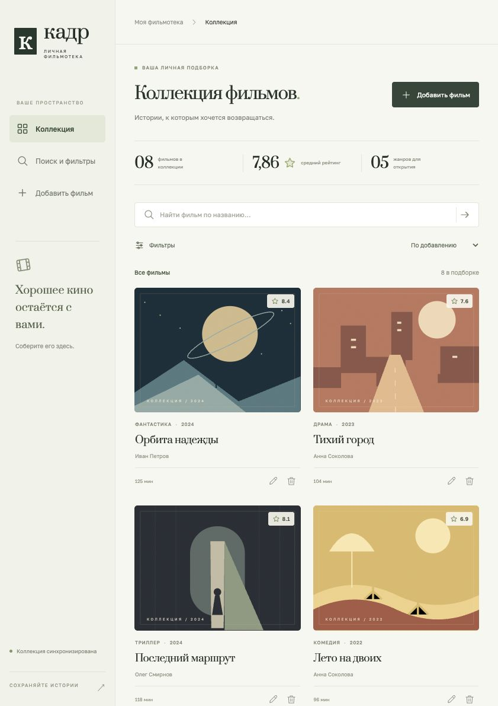
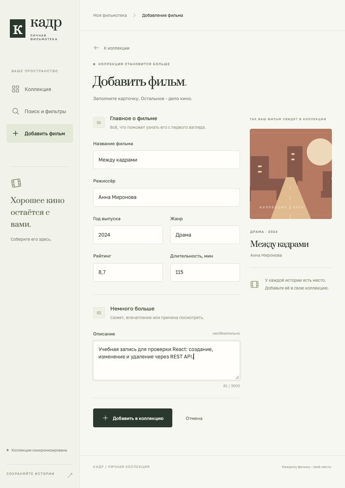
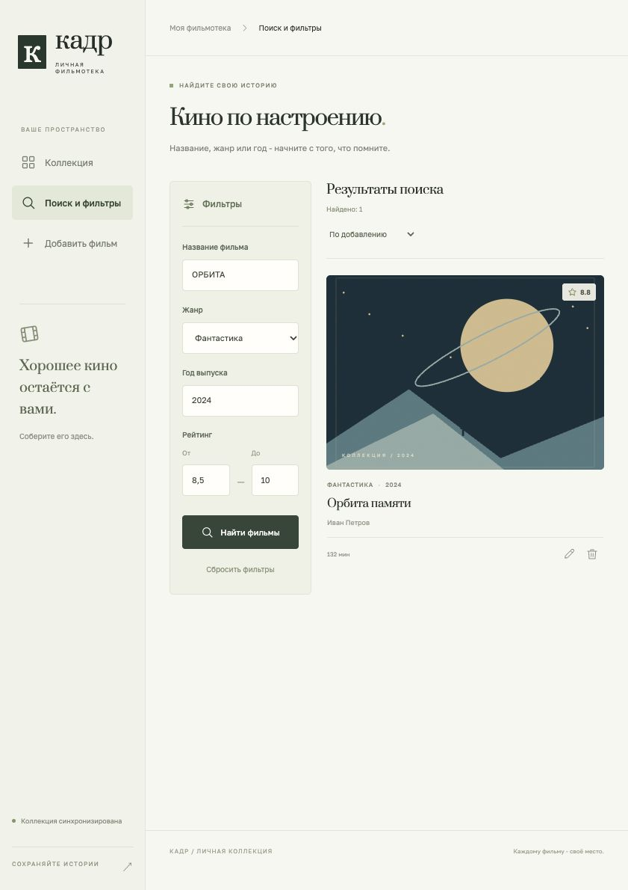
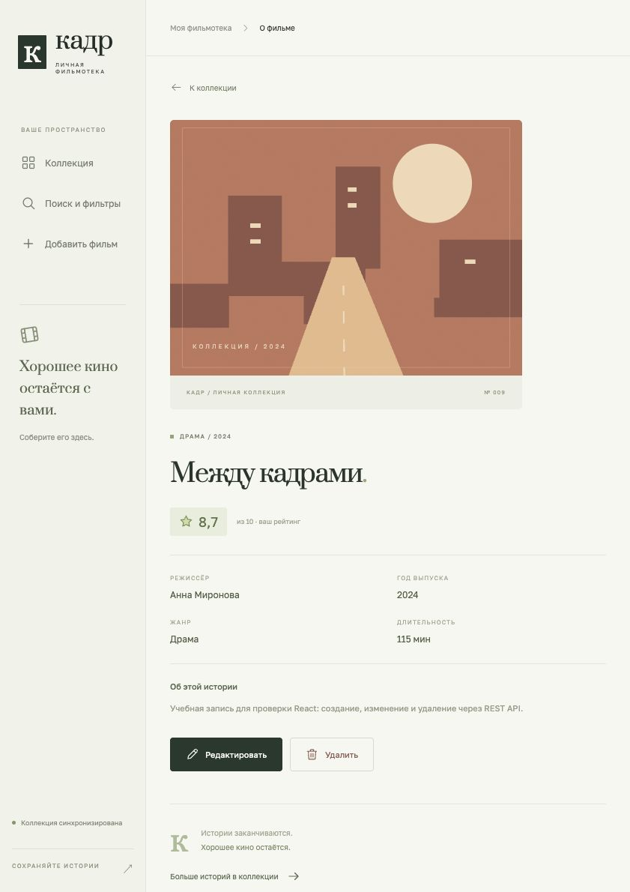

# Лабораторная работа №2: React + REST API

**МТУСИ · Программная инженерия · Новосельцев Алексей Сергеевич · БСТ-2556**

«Кадр» - React-интерфейс к API фильмотеки из лабораторной №1. Используются
React, React Router, Vite, обычный CSS и встроенный `fetch`. Данные загружаются
из FastAPI и сохраняются в SQLite. Подмена запросов статическим JSON отсутствует.
Постеры - оригинальные SVG-композиции, зависящие от жанра; в модель БД новые поля не добавляются.

## Запуск

Нужны Python 3.12+ и Node.js 22.12+ (проверено на Node.js 24).
Команды backend выполняются из корня репозитория:

```bash
python3 -m venv .venv
source .venv/bin/activate
python -m pip install -r requirements.txt
python -m app.seed
python -m uvicorn app.main:app --reload
```

В другом терминале, из корня репозитория:

```bash
npm install --global pnpm@11.25.0
cd frontend
pnpm install --frozen-lockfile
pnpm dev
```

Открыть <http://127.0.0.1:5173>. Backend работает на <http://127.0.0.1:8000>,
его Swagger UI - на <http://127.0.0.1:8000/docs>.
В Windows активация Python-окружения: `.venv\Scripts\activate`.

По умолчанию клиент обращается к `http://127.0.0.1:8000`. При необходимости
скопируйте `.env.example` в `.env.local` и измените `VITE_API_URL`;
после изменения перезапустите Vite. Адрес содержит только origin backend, без `/api/v1`.

## Экраны и навигация

| Путь React | Экран | Действия |
|---|---|---|
| `/` | Коллекция | Карточки, статистика, поиск по названию, сортировка, страницы |
| `/movies/new` | Добавление | Валидация и отправка POST |
| `/movies/:id/edit` | Редактирование | Загрузка существующих полей и полная отправка PUT |
| `/search` | Поиск и фильтры | Название, жанр, год, диапазон рейтинга; сортировка и страницы |
| `/movies/:id` | Детали | Просмотр всех полей, переход к изменению и удаление |

Требование минимум трёх экранов выполнено: коллекция, общая форма,
отдельный поиск и детали. Параметры поиска хранятся в URL и сохраняются при
обновлении страницы. Удаление требует подтверждения в диалоге; отмена не отправляет DELETE.

## Структура

```text
frontend/
  src/main.jsx       подключение React и BrowserRouter
  src/App.jsx        навигация и экраны
  src/api.js         fetch, ошибки HTTP, query, валидация и JSON
  src/components.jsx карточки, SVG-постеры, поля, диалог, хук загрузки
  src/styles.css     оформление и медиазапросы
  tests/api.test.js  проверки клиентской логики (Node test runner)
  public/favicon.svg значок приложения
  vite.config.js    настройки сервера и сборки
  pnpm-lock.yaml    версии зависимостей
app/main.py          FastAPI и CORSMiddleware
tests/test_cors.py   проверки разрешённых origin и preflight
docs/lab2/           результаты проверок и скриншоты
```

## Основные маршруты API

| Метод и путь | Использование в интерфейсе |
|---|---|
| `GET /api/v1/movies` | Список и поиск; `q`, `year`, `genre`, `rating_min`, `rating_max`, `sort_by`, `order`, `page`, `page_size` |
| `GET /api/v1/movies/{id}` | Детали и исходные значения формы |
| `POST /api/v1/movies` | Добавление, ответ 201 с `id` |
| `PUT /api/v1/movies/{id}` | Полная замена, ответ 200 |
| `DELETE /api/v1/movies/{id}` | Удаление, ответ 204 без JSON |
| `GET /api/v1/genres` | Варианты жанра |
| `GET /api/v1/movies/stats` | Число фильмов, средний рейтинг, число жанров |
| `GET /health` | Состояние соединения в боковом меню |

Примеры запросов из браузерного JavaScript:

```js
const base = 'http://127.0.0.1:8000';
const query = new URLSearchParams({ q: 'ОРБИТА', year: '2024', rating_min: '8.5' });
const response = await fetch(`${base}/api/v1/movies?${query}`);
if (!response.ok) throw new Error(`HTTP ${response.status}`);
const page = await response.json();

const movie = {
  title: 'Между кадрами', director: 'Анна Миронова', year: 2024,
  genre: 'Драма', rating: 8.7, duration_minutes: 115, description: null,
};
const createdResponse = await fetch(`${base}/api/v1/movies`, {
  method: 'POST', headers: { 'Content-Type': 'application/json' },
  body: JSON.stringify(movie),
});
if (!createdResponse.ok) throw new Error(`HTTP ${createdResponse.status}`);
const created = await createdResponse.json();

const updatedResponse = await fetch(`${base}/api/v1/movies/${created.id}`, {
  method: 'PUT', headers: { 'Content-Type': 'application/json' },
  body: JSON.stringify({ ...movie, rating: 9.3 }),
});
if (!updatedResponse.ok) throw new Error(`HTTP ${updatedResponse.status}`);

const deletedResponse = await fetch(`${base}/api/v1/movies/${created.id}`, { method: 'DELETE' });
if (!deletedResponse.ok) throw new Error(`HTTP ${deletedResponse.status}`);
// Для 204 не вызываем response.json().
```

В `src/api.js` эта логика объединена в `request()`: проверяются `response.ok`,
ошибки сети и ответы 422; ошибки полей передаются форме. Числовые значения
преобразуются через `Number()` перед сериализацией, пустое описание - в `null`.
`useResource` отменяет запросы через `AbortController` при смене маршрута или
фильтров, чтобы старый ответ не заменял новые результаты. Во время сохранения
форма блокируется. Реализованы индикаторы загрузки, пустые состояния, 404 и повтор запроса.

## CORS

Запросы выполняются **напрямую с порта 5173 на 8000**, Vite proxy не используется.
В FastAPI добавлен `CORSMiddleware` с origin:

- `http://127.0.0.1:5173`, `http://localhost:5173`;
- `http://127.0.0.1:4173`, `http://localhost:4173` (preview сборки).

Разрешены GET, POST, PUT, DELETE и заголовок `Content-Type`. Для JSON-запросов
браузер выполняет OPTIONS preflight, который обрабатывает middleware.
`Location` доступен клиенту через `expose_headers`. Cookies не используются.
Другие origin можно перечислить в переменной `CORS_ORIGINS` через запятую.
Запуск frontend на другом порту требует добавить его origin в этот список.

## Проверка и сборка

```bash
# Из frontend:
pnpm test
pnpm build
pnpm preview

# Из корня репозитория с активным Python-окружением:
python -m pip install -r requirements-dev.txt
python -m pytest
```

Проверено: **73 backend-теста** (включая 7 CORS), **16 клиентских тестов**,
сборка Vite. Покрытие строк backend без seed - 99%. В браузере вручную
пройден полный цикл создания, чтения, изменения, обновления страницы и удаления,
проверены ошибки ввода, поиск, сортировка, страницы, пустая выдача и отмена удаления.
Контрольный фильм после проверки удалён; исходные учебные записи сохранены.

Автоматические клиентские тесты проверяют fetch, GET/POST/PUT/DELETE, 204,
ошибки HTTP и сети, отмену запросов, сборку query, JSON и валидацию.
Это проверки клиентской логики; проверка всего интерфейса выполнена отдельно в браузере.
GitHub Actions запускает тесты Python, тесты JavaScript и сборку React.
Фактические результаты: `docs/lab2/backend-tests.xml`, `frontend-tests.xml`,
`browser-checks.json`, `coverage.json`.

## Скриншоты работы

Коллекция:



Добавление:



Поиск с фильтрами:



Детали:



Также сохранены `edit.jpg` и `delete.jpg`. PDF второй работы:
[output/pdf/lab2-report.pdf](../output/pdf/lab2-report.pdf).
Для повторной сборки PDF из корня проекта: установите `requirements-report.txt`
и выполните `python -m scripts.build_report2`. Скрипт использует сохранённые
результаты тестов и скриншоты. Нужны Times New Roman и Courier New
(macOS/Windows) либо DejaVu Serif и DejaVu Sans Mono (Linux).

## Справочные материалы

- [React: синхронизация через эффекты](https://react.dev/learn/synchronizing-with-effects).
- [Vite: запуск и сборка](https://vite.dev/guide/).
- [FastAPI: CORS](https://fastapi.tiangolo.com/tutorial/cors/).
- [MDN: использование Fetch API](https://developer.mozilla.org/en-US/docs/Web/API/Fetch_API/Using_Fetch).
